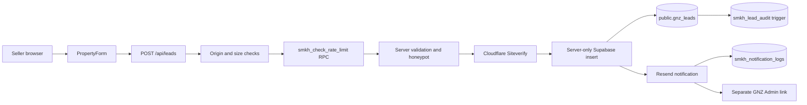

# Adam partnership demonstration — Phase A repository audit

**Audit date:** November 1, 2026
**Scope:** Read-only inspection of the `SellMyKernHome` repository, its public deployment output, and repository documentation.
**Repository state audited:** `main` at `c3ed843aaf13a88930cbb4d5465d9c54ff27af5a`
**Production actions:** None. No form submission, database query, email, deployment, DNS change, secret change, or analytics test event was performed.

## Executive conclusion

SellMyKernHome (SMKH) is a standalone Next.js public seller-inquiry site, but its operating workflow is not independent. A successful form submission writes through a server-only Supabase service client into the shared `public.gnz_leads` table, sends an intentionally PII-free notification containing a GNZ Admin link, and relies on the separate GNZ Admin application for human review and updates.

The existing public funnel is a useful foundation for an Adam demonstration. The form validation, Turnstile enforcement, database-backed rate-limit path, source/UTM attribution, idempotency token, notification ordering, RLS/grant migration, and audit-attributed Admin RPC are reusable patterns. The public UI should remain branded Sell My Kern Home.

The repository is not ready for the proposed partnership demonstration without additional work. It has no SMKH Admin routes, no authentication/session implementation, no private-staging access control, no Property Intelligence (PI) link or API integration, no staging-specific data/notification isolation in source configuration, and no GA4 consent-mode flow. GNZ is also hard-coded in public copy, structured data, consent text, email copy, the database table name, the Admin URL variable, and authorization membership.

Two production facts are materially ambiguous and must be resolved before Phase B:

1. Older files say the seller migration is unapplied, while the later production execution report says the authorized migration was applied on October 14, 2026.
2. The new Stage 1 brief says GNZ has no stored seller leads, while the production execution report records one intentionally retained synthetic seller lead.

No production database check was made in this phase, so neither point is treated as currently verified.

## 1. Existing architecture

### Runtime and deployment

- JavaScript Next.js App Router application. `package.json` requests Next `^16.2.6`; the installed and built version is 16.4.1 (`package.json:1-29`).
- React 19.2.6, Supabase JS 2.95.3, Resend 6.28.1, Lucide React, and `ws` are the principal runtime dependencies (`package.json:19-28`).
- Netlify runs `npm run build`, publishes `.next`, and is configured for Node 20 (`netlify.toml:1-7`). The local audit host used Node 24.22.1, so parity testing under Node 20 remains advisable.
- Deploy previews and branch deploys set `NEXT_PUBLIC_ROBOTS_INDEX=false`, but no preview access control or environment isolation is declared in `netlify.toml` (`netlify.toml:9-13`).
- There is no `middleware.js` or `proxy.js`. There is therefore no application-level staging gate or route-wide authentication layer.
- Security response headers are defined in Next configuration: no-sniff, strict referrer policy, frame denial, restrictive permissions policy, and COOP (`next.config.js:6-20`).
- The Netlify hostname permanently redirects to `https://sellmykernhome.com`; three legacy situation URLs also redirect to permanent seller landing pages (`next.config.js:22-33`).

### Route model

The application contains:

- Public static/SSG pages: home, about, contact, FAQ, how-it-works, privacy, terms, thank-you, insights, seller landing pages, and selling-situation pages.
- One dynamic server Route Handler: `POST /api/leads` (`app/api/leads/route.js:18-35`).
- Metadata routes: `/robots.txt` and `/sitemap.xml` (`app/robots.js`, `app/sitemap.js`).
- No `/admin`, login, settings, export, PI, callback, or authenticated API routes.

The production build generated 30 pages/assets and completed successfully during this audit.

### Component boundaries

- Server-rendered layout/content: `app/`, `components/PageHero.js`, `components/SellerLandingPage.js`, `components/SituationGrid.js`, and content modules.
- Client-side interactive surface: navigation, analytics click hooks, `PropertyForm`, and `TurnstileWidget`.
- Shared configuration and metadata: `lib/site.js`.
- Server-only integration modules: `lib/supabase.js`, `lib/leads.js`, `lib/notifications.js`, and `lib/rateLimit.js` use `server-only` (`lib/supabase.js:1`, `lib/leads.js:1`, `lib/notifications.js:1`, `lib/rateLimit.js:1`).
- The public Supabase URL and publishable key exist in configuration, but the browser application does not instantiate a Supabase client. Lead access is server-side.

### Request/data flow

## 2. Seller inquiry trace

### Browser collection and validation

- Required first-step fields are address, city, ZIP, name, selected contact channel, the matching valid email/phone, and privacy acknowledgement (`components/PropertyForm.js:14-24`).
- The Continue button remains disabled until client validation passes (`components/PropertyForm.js:119-133`).
- Phone input is formatted as a US number (`components/PropertyForm.js:26-34`, `components/PropertyForm.js:75-79`).
- Optional second-step fields are property type, condition, occupancy, desired timing, comments, and marketing consent (`components/PropertyForm.js:135-140`).
- Attribution captures landing URL without query parameters, referrer, and five UTM fields, with client-side length bounds (`components/PropertyForm.js:36-48`).
- A UUID submission token is created once per mounted form and reused for retries (`components/PropertyForm.js:52-54`).
- The consent version is hard-coded as `2026-10-14-draft`, which is not suitable as a final approved consent artifact (`components/PropertyForm.js:99`).

### Turnstile

- The browser receives only `NEXT_PUBLIC_TURNSTILE_SITE_KEY`; the secret is read only by server code (`components/TurnstileWidget.js:7-19`, `lib/rateLimit.js:26-35`).
- Missing production site-key configuration leaves the form without a usable verification widget and renders an error (`components/TurnstileWidget.js:28-29`).
- Expired, timed-out, and widget errors clear the token; server errors reset the widget (`components/TurnstileWidget.js:9-27`, `components/PropertyForm.js:102-114`).
- The submit button requires a client token, but the server independently verifies it before creating a lead (`components/PropertyForm.js:143`, `app/api/leads/route.js:28-30`).
- Siteverify checks `success`, uses the request IP when known, times out after six seconds, and fails closed (`lib/rateLimit.js:26-35`). The response hostname/action is not independently asserted by application code.

### Server validation and abuse controls

The Route Handler performs these operations in order:

1. Origin check (`app/api/leads/route.js:8-19`). Requests with no `Origin` header are accepted.
2. 32 KiB declared content-length limit (`app/api/leads/route.js:20`).
3. IP-derived rate limit (`app/api/leads/route.js:21-22`).
4. JSON parsing and allow-listed server validation (`app/api/leads/route.js:23-26`, `lib/validation.js:21-45`).
5. Honeypot and elapsed-time check: at least 1.5 seconds and no more than 24 hours (`app/api/leads/route.js:27`, `lib/validation.js:47-50`).
6. Server-side Turnstile verification (`app/api/leads/route.js:28`).
7. Lead creation and response (`app/api/leads/route.js:29-33`).

The database rate-limit RPC is preferred. If it errors or returns no row, code falls back to an in-memory map (`lib/rateLimit.js:17-24`). That fallback is useful locally but does not provide a globally reliable limit across serverless instances. The normal limit is five requests per IP-derived HMAC key per 15 minutes (`lib/rateLimit.js:17-18`).

### Insert, source attribution, deduplication, and notification

- The server writes `source=seller_web`, `lead_type=seller`, `source_site=sellmykernhome.com`, `service=seller-property`, `status=new`, the property/contact fields, attribution, and consent into `public.gnz_leads` (`lib/leads.js:7-12`).
- Exact retry idempotency is based on the unique `submission_token`. A `23505` conflict looks up and returns the existing record without another notification (`lib/leads.js:12-16`). There is no semantic deduplication across different tokens for the same address/contact.
- Lead storage occurs before notification. Failed Turnstile or validation cannot reach insertion, and failed insertion cannot send notification (`app/api/leads/route.js:25-30`, `lib/leads.js:12-16`).
- Notification failure does not roll back a stored lead. It is returned internally as a delivery result while the public request still succeeds (`lib/leads.js:15-16`).
- Resend recipients, sender, and reply-to are environment-controlled. The message contains only the reference and secure GNZ Admin URL; it intentionally excludes seller PII (`lib/notifications.js:5-20`).
- Delivery attempts are written to `smkh_notification_logs` (`lib/notifications.js:6`, `lib/notifications.js:18-20`).

## 3. Supabase schema and authorization

### Shared GNZ objects

The migration requires the pre-existing `public.gnz_leads` and `public.admin_users` tables and fails if either is missing (`supabase/migrations/20261014_sellmykernhome_leads.sql:5-14`). It then:

- Adds 13 seller/source/property/consent/assignment columns to `gnz_leads` (`supabase/migrations/20261014_sellmykernhome_leads.sql:16-29`).
- Preserves existing records by defaulting them to `lead_type=investor` and `source_site=gnzmarketingllc.com`.
- Expands allowed statuses to `new`, `contacted`, `qualified`, `in_discussion`, `closed`, and `not_proceeding` (`supabase/migrations/20261014_sellmykernhome_leads.sql:31-40`).
- Adds notification logs, seller audit records, and database rate-limit state (`supabase/migrations/20261014_sellmykernhome_leads.sql:45-69`, `supabase/migrations/20261014_sellmykernhome_leads.sql:116-120`).
- Adds a seller-only audit trigger to the shared lead table (`supabase/migrations/20261014_sellmykernhome_leads.sql:71-114`).

The migration file's current SHA-256 is `0F2027D2883FBD0F29EC564CE062916C368FEE3F76E8BF43638AEE5C0F2FC175`, matching the artifact recorded in the production execution report (`docs/production-migration-execution-20261014.md:6-12`).

### Access controls

- RLS is enabled on the shared lead table and all three SMKH tables (`supabase/migrations/20261014_sellmykernhome_leads.sql:222-227`).
- All table access is revoked from `PUBLIC`, `anon`, and `authenticated` (`supabase/migrations/20261014_sellmykernhome_leads.sql:229-231`).
- `service_role` is reset to only SELECT, INSERT, and UPDATE on `gnz_leads`; it has no intended DELETE privilege (`supabase/migrations/20261014_sellmykernhome_leads.sql:233-241`).
- SECURITY DEFINER functions use `search_path=pg_catalog`, schema-qualify application objects, revoke browser execution, and grant only the needed service-role RPCs (`supabase/migrations/20261014_sellmykernhome_leads.sql:71-75`, `supabase/migrations/20261014_sellmykernhome_leads.sql:122-130`, `supabase/migrations/20261014_sellmykernhome_leads.sql:178-188`, `supabase/migrations/20261014_sellmykernhome_leads.sql:243-256`).
- The Admin mutation RPC verifies both actor and assignee against `public.admin_users`, sets transaction-local actor context, and updates the shared record (`supabase/migrations/20261014_sellmykernhome_leads.sql:175-220`).

The database function can verify that a supplied actor ID belongs to `admin_users`; it cannot establish which browser session supplied that ID. The trusted server caller must obtain the actor from an authenticated server-side session and must never accept it from request JSON. That implementation exists only in the separate GNZ Admin repository according to documentation; it is not present here.

### Current schema mismatch with the proposed demo

The Stage 1 brief proposes `Contact Attempted`, `Appointment`, `Offer Made`, `Under Contract`, and `Lost`. The current shared constraint supports only `contacted`, `in_discussion`, and `not_proceeding` equivalents. There is also no follow-up-date column. Status mapping versus a new isolated demo schema must be decided before dashboard implementation; changing the shared production constraint is not authorized by Phase A.

## 4. GNZ dependency inventory

| Dependency | Evidence | Demo implication |
|---|---|---|
| Shared lead storage | `lib/leads.js:11-14` | Current form cannot be pointed at a demonstration without changing environment/schema routing. Do not use production data. |
| GNZ Admin URL | `lib/notifications.js:11-17`, `.env.example:18-19` | Notifications send operators out of SMKH to a separate GNZ application. |
| GNZ membership | Migration RPC checks `public.admin_users` at lines 191-200 | Adam cannot have independent SMKH authorization without an isolated demo membership or an approved membership-model change. |
| GNZ public copy | `app/page.js:19,30,43`; `app/about/page.js:7`; `app/contact/page.js:5-6`; `app/how-it-works/page.js:13` | Operator/parent copy must become validated configuration before an Adam demo. Public brand should remain SMKH. |
| Consent text | `components/PropertyForm.js:131` | Names GNZ as recipient and uses a draft version string; requires owner/legal approval and staging-safe operator copy. |
| Privacy/terms | `app/privacy-policy/page.js:4-5`; `app/terms/page.js` | Privacy policy names authorized GNZ administrators and has not been adapted for Adam or a staging demonstration. |
| Thank-you and FAQ | `app/thank-you/page.js:5`; `app/faq/page.js:6,12` | Post-submission and explanatory copy assumes GNZ handling. |
| Footer | `components/Footer.js:7,12` | Public affiliation is hard-coded. |
| Structured data | `app/page.js:18-20` | Organization schema declares GNZ Marketing Group, LLC as parent organization. |
| Existing-record defaults | Migration lines 16-18 | Existing GNZ data is explicitly classified as investor/GNZ source. |
| Verification tooling | `scripts/verify-integration.mjs:12-55` | Optional credentials authenticate existing GNZ admins and inspect membership; this script must not be used with production credentials for the demo. |
| Separate Admin code | `docs/final-codex-report.md:10`; production commit recorded at `docs/production-migration-execution-20261014.md:32-41` | The actual Admin/session/UI code is outside this repository and was not inspected in Phase A. |

No GNZ logo asset was found in this repository; the visible logo is the SMKH mark. GNZ coupling is copy, structured data, configuration, database, authorization, notifications, and operational workflow rather than a reused visible logo.

## 5. Admin reuse assessment

There is no SMKH Admin code to adapt in this repository. Repository documentation names GNZ-side files and a deployed GNZ commit, but those source files are not available within the authorized repository scope (`docs/final-codex-report.md:10`, `docs/production-migration-execution-20261014.md:32-41`).

Confirmed reusable elements:

- Supabase Auth plus a membership table as the authorization pattern.
- Server-side session verification before service-role operations.
- The service-role-only `smkh_admin_update_lead` RPC and its transaction-local audit attribution.
- Existing lead field mappings, notes, assignee, status, audit, and notification-log schema.
- GNZ Admin UI concepts documented as seller/investor filtering, detail review, assignment, and status editing.

Not yet confirmed reusable:

- GNZ session-cookie implementation and expiration behavior.
- Login/reset/logout flows.
- Server authorization helpers.
- Admin layouts/components and their licensing/ownership boundary.
- CSV/export logic; prior audit says no restricted export exists (`docs/integration-audit.md:35-36`).
- Any existing follow-up scheduling functionality.

Before adapting Admin code, either authorize a read-only audit of the current GNZ Admin repository or implement a minimal independent SMKH Admin against an isolated staging Supabase project. Production GNZ accounts, sessions, memberships, and secrets must not be copied into the demonstration.

## 6. Property Intelligence handoff

No executable/configuration reference to Property Intelligence, RadiusIQ, a PI URL, API, export, deep link, OAuth flow, or service credential exists in this repository. The current product has no PI handoff.

Required discovery before implementation:

1. Confirm the intended PI product and environment URL.
2. Identify the account owner and authentication/session model.
3. Confirm whether a documented API, signed deep link, or import format exists.
4. Define the minimum non-PII property fields that may cross the boundary.
5. Decide whether Stage 1 should use a manual, synthetic property workflow instead of an integration.
6. Define failure/fallback behavior and ensure the public site never claims automatic transfer unless it exists.

The safest current Stage 1 assumption is a scripted manual handoff using one synthetic Kern County property and no seller contact details.

## 7. SEO and deployed indexing state

### Repository behavior

- Canonical origin is hard-coded to `https://sellmykernhome.com`; `NEXT_PUBLIC_SITE_URL` is listed in environment documentation but is not used by `lib/site.js` (`lib/site.js:1-10`, `.env.example:1-3`).
- Root and page metadata include titles, descriptions, canonicals, Open Graph, and Twitter cards (`app/layout.js:14-30`, `lib/site.js:15-23`).
- Root indexing is gated by `NEXT_PUBLIC_ROBOTS_INDEX` (`app/layout.js:12-19`).
- `robots.txt` allows public crawling, disallows `/api/` and `/thank-you`, and publishes a sitemap link only when indexing is enabled (`app/robots.js:3-8`).
- Sitemap generation returns an empty list when indexing is disabled. Every seller landing page and article is currently marked `approvedForIndexing=false`, so drafts cannot enter the sitemap (`app/sitemap.js:7-14`, `content/seller-pages.js:3-87`, `content/articles.js:3-55`).
- The thank-you page is explicitly `noindex,nofollow`; privacy and terms are `noindex,follow` (`app/thank-you/page.js:4`, `app/privacy-policy/page.js:4`, `app/terms/page.js:4`).
- Structured data includes Organization, WebSite, BreadcrumbList, and Article. No LocalBusiness schema is present (`app/page.js:18-23`, `components/Breadcrumbs.js:5-17`, `app/insights/[slug]/page.js:25-32`). This is appropriate until a real eligible business identity/location is confirmed.
- No Search Console verification metadata or verification file was found.

### Public output observed November 1, 2026

A public GET-only inspection found:

- Production branch `main` deployed at repository commit `c3ed843aaf13a88930cbb4d5465d9c54ff27af5a`.
- Canonical points to the permanent domain.
- Root HTML contains `noindex`.
- `robots.txt` allows `/` and disallows `/api/` and `/thank-you`.
- `/sitemap.xml` returns successfully but contains zero URLs.
- The Netlify hostname returns a 308 redirect to the permanent domain.
- Organization schema is present; LocalBusiness schema is absent.

The public site is therefore intentionally prevented from indexing despite being reachable. A private Adam staging deployment needs both noindex and actual access control; noindex alone is not privacy.

## 8. GA4 audit

### Current implementation

- GA4 loads only when `NEXT_PUBLIC_GA_MEASUREMENT_ID` exists (`app/layout.js:32-45`).
- When configured, the script loads after hydration and immediately calls `gtag('config', ..., {send_page_view:true, allow_google_signals:false})` (`app/layout.js:42-45`).
- There is no consent default, consent update, rejection, withdrawal, or cookie-control implementation anywhere in the repository.
- There is no explicit App Router navigation listener, so only the initial configured page view is assured by this code; client-side route changes are not explicitly tracked.
- The success event is the custom `seller_form_submit_success`, not the recommended GA4 `generate_lead` event (`components/PropertyForm.js:109`).
- Other implemented events are `seller_form_start`, validation error, form step, primary CTA click, telephone click, and email click (`components/PropertyForm.js:72-109`, `components/Analytics.js:6-17`, `components/CTA.js:5`, `components/Header.js:21`).
- `track()` strips parameters whose keys resemble common PII names, and current call sites use non-PII parameters (`lib/analytics.js:1-5`). This is a useful guard, not a complete data-loss-prevention control; safe event schemas still need enforcement.

### Deployed behavior

The public HTML inspected on November 1 did not contain the GA4 loader, consistent with a missing or empty production measurement ID. No browser event was generated, and GA4 Realtime/DebugView/Search Console were not accessed.

Before any demo analytics are enabled:

1. Implement denied consent defaults before analytics storage or collection.
2. Add explicit accept/reject/update/withdrawal behavior.
3. Use a staging-only measurement ID or disable GA entirely on staging.
4. Add explicit App Router page-view handling and prevent duplicates.
5. Map successful submission to `generate_lead` while retaining only approved non-PII dimensions.
6. Verify network behavior and GA4 DebugView with owner-authorized Google access; a 204 response is not sufficient evidence.

## 9. Test and verification posture

### Existing automated coverage

- Validation tests cover accepted data, selected contact requirements, enum rejection, privacy acknowledgement, honeypot/timing, and GNZ name splitting (`tests/validation.test.js:9-25`).
- PGlite migration regression creates a legacy GNZ schema and verifies data preservation, ACL reset, browser denial, service-role no-delete, system/admin audit attribution, outsider rejection, rate limiting, and legacy/new statuses (`tests/migration.test.js:18-226`).
- Static tests inspect routes, indexing, canonical/sitemap behavior, migration hardening, Admin RPC attribution, rollback gating, notification PII exclusion, analytics parameter filtering, and server validation ordering (`tests/content.test.js:9-78`).
- Browser tests cover required routes, first-step validation, phone formatting, responsive accessibility, crawl controls, and screenshots at six viewport sizes (`tests/e2e/site.spec.js:5-69`, `playwright.config.js:3-15`).
- Isolated Turnstile tests use Cloudflare test keys and a local mock Supabase service to verify missing/invalid/spent tokens, rate limiting, successful source/UTM attribution, insert-before-notification ordering, and retry UI (`tests/e2e/turnstile.spec.js:49-156`, `playwright.turnstile.config.js:3-62`).

### Checks run during Phase A

- `npm run lint`: PASS.
- `npm test`: PASS, 18/18.
- `npm run build`: PASS, Next.js 16.4.1, 30 generated pages/assets.
- `npm audit --audit-level=high`: high-severity threshold passed, but npm reports five moderate transitive `minimatch` vulnerabilities through the ESLint toolchain. The suggested automatic force fix is breaking and was not run.
- Live E2E, production database, production email, GA4, Search Console, and PI tests were not run.

`.env.local` is ignored and not tracked. The local file contains configured integration/admin values, but no values were printed or copied. Optional `ADMIN*` credentials are explicitly documented as unsuitable for a deployed public-site environment (`.env.example:28-33`).

## 10. Risks and blockers

| Priority | Finding | Required response |
|---|---|---|
| Blocker | No isolated staging database or data-routing boundary is declared. Reusing current environment values could write to shared GNZ production. | Create a separate staging Supabase project or equivalently isolated database and use synthetic data only. |
| Blocker | No private staging access control exists. | Protect the staging site through Netlify access controls or reviewed application authentication in addition to noindex. |
| Blocker | No SMKH Admin/auth implementation exists in this repository. | Audit authorized GNZ code or build a minimal independent staging Admin with server-side authorization on every operation. |
| Blocker | Production documentation conflicts about migration state and seller-record count. | Perform a separately authorized, read-only production verification and reconcile documentation before any cutover plan. |
| High | GNZ identity and workflow are hard-coded throughout public copy, consent, schema, email, data, and authorization. | Introduce validated server/public configuration with safe defaults; keep SMKH as the public brand and expose only legally approved operator disclosures. |
| High | Proposed Adam statuses and follow-up date do not match the current schema. | Approve a demo status map/schema before dashboard work; do not alter production as part of staging. |
| High | GA4 has no consent-mode sequence and no explicit SPA page-view handling. | Keep GA disabled for the demo until consent and measurement behavior are implemented and certified. |
| High | No PI handoff exists. | Obtain PI product/auth/API facts; use a synthetic manual handoff if integration is unavailable. |
| High | Staging notifications are not source-isolated by checked-in configuration. | Use staging-only sender/recipients and verify no GNZ or Adam recipient receives tests without authorization. |
| Medium | Rate-limit RPC errors silently fall back to per-instance memory. | Add observable failover behavior and decide whether production/staging should fail closed or use durable external limiting. |
| Medium | Turnstile response hostname/action is not checked in application code. | Bind and verify expected hostname/action for staging and production as part of implementation testing. |
| Medium | Idempotency prevents exact token replay but not same-person/property duplicates under new tokens. | Define operational duplicate handling; avoid opaque automated merging. |
| Medium | `NEXT_PUBLIC_SITE_URL` is documented/configured but canonical origin is hard-coded. | Clarify whether Stage 1 staging should retain production canonicals or use explicit environment-aware metadata while noindexed. |
| Medium | Local Node version differs from Netlify Node 20. | Run final staging verification on Node 20. |
| Medium | Five moderate dev-tool dependency vulnerabilities are reported. | Review an ESLint-compatible dependency update; do not apply npm's breaking force fix blindly. |
| Legal gate | Adam's license, brokerage, advertising role, transaction role, and revenue arrangement are unverified. | Obtain owner/counsel-approved disclosure and commercial terms before publishing claims or implementing transaction-based payments. |

## 11. Everything required for the Adam demonstration

1. **Resolve ownership and legal facts:** approved entity/operator configuration, Adam's verified role/license/brokerage disclosures if applicable, privacy/retention terms, and prohibited claim matrix.
2. **Reconcile production facts:** migration state, existing seller/synthetic lead count, current GNZ Admin release, and credential-rotation status. Read-only verification requires separate authorization.
3. **Private staging site:** separate Netlify site/context, access restriction, noindex, empty sitemap, production-domain canonical decision, no public DNS cutover.
4. **Environment isolation:** staging-only Supabase URL/keys, Turnstile widget, HMAC secret, Resend configuration, recipients, Admin URL, and analytics setting. Do not deploy `ADMIN*` verification credentials.
5. **Synthetic database:** apply the verified schema to an isolated staging project, seed only synthetic GNZ-compatible records, and prove RLS/ACL/RPC behavior.
6. **Independent Admin access:** create an Adam demo Auth user only after approval, grant least-privilege membership in staging only, enforce server session verification, and prevent actor IDs from browser input.
7. **Dashboard scope:** lead list/detail, contact/property/source/UTM display, status, assignee, notes, follow-up date decision, audit display, session expiry, and unauthorized-access tests.
8. **Workflow decision:** map or approve statuses and define qualification/follow-up behavior without adding automated seller contact.
9. **Notification isolation:** reference-only demo emails to approved test recipients after successful synthetic lead creation; delivery logging and failure-state evidence.
10. **Public configuration:** keep SMKH branding; make operator/recipient/admin/structured-data dependencies explicit and legally reviewed rather than replacing the brand with Adam.
11. **PI demonstration:** confirm PI product/auth capabilities, choose a synthetic property, define minimal export/handoff fields, create a manual fallback, and prevent seller PII transfer.
12. **Analytics/SEO controls:** keep staging analytics disabled or isolated; add consent before GA4; retain noindex and access control; exclude staging from Search Console/sitemap.
13. **Acceptance evidence:** validated lead creation exactly once, failed Turnstile side-effect proof, rate-limit proof, authorized/unauthorized Admin tests, audit actor proof, notification proof, PI click path, screenshots, lint/tests/build/audit results, and rollback instructions.

## 12. Recommended Stage 1 implementation sequence

1. Resolve the four owner decisions: production-fact reconciliation, legal/operator identity, status/follow-up model, and PI access model.
2. Design the Phase B environment/data/auth matrix with explicit production, staging, and local boundaries.
3. Create the private noindex staging shell and isolated Supabase project; migrate and test with synthetic data.
4. Audit the current GNZ Admin source under separately authorized scope, then choose minimal adaptation versus an independent SMKH Admin.
5. Implement staging-only Admin authentication, lead views/mutations, audit attribution, and notification routing.
6. Configure the public funnel for the staging operator while preserving SMKH branding and all abuse/privacy controls.
7. Build the PI demonstration as a manual secure handoff unless an authenticated supported integration is confirmed.
8. Implement/certify analytics consent only if it is required for the demonstration; otherwise leave staging analytics disabled.
9. Execute the complete synthetic acceptance script and document rollback. Do not cut over production without a later explicit authorization.

## Phase A stop point

Phase A is complete. No application code or production resource was changed. Phase B should not begin until the material ambiguities and owner decisions above are approved or explicitly deferred with safe assumptions.
