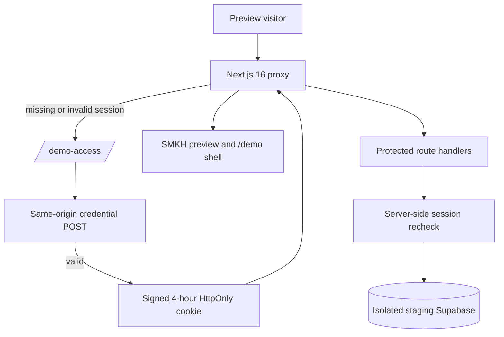
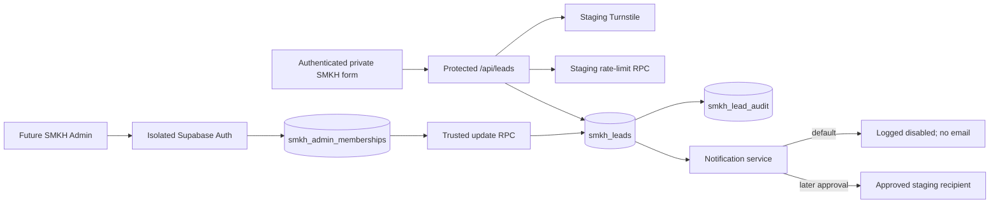

# Adam partnership demonstration — Phase B architecture and isolation

> Superseded on November 1, 2026. Do not provision or deploy the staging design described below.

**Prepared:** November 1, 2026
**Baseline:** [`docs/adam-demo/01-repository-audit.md`](../adam-demo/01-repository-audit.md). The requested `docs/adam-partnership/01-repository-audit.md` path did not exist, so the completed Phase A report was used without moving or duplicating it.
**Status:** Local implementation prepared; no external resource provisioned and no production change authorized.

## Outcome

Phase B establishes a fail-closed private staging shell, a guarded independent SMKH database design, a synthetic PI scenario, and explicit environment boundaries. Sell My Kern Home remains the public consumer brand. Workside Software LLC is identified only inside the private demonstration as technology owner/controller. Adam is not added to public branding or represented as a buyer, broker, or licensee.

The implementation is deliberately incomplete until isolated external resources and approved credentials exist. Netlify preview configuration enables demo mode but does not contain credentials. A preview therefore returns `503 Private staging access is not configured` until the staging-only access secrets are deliberately supplied.

## Environment and data-isolation matrix

| Concern | Production | Private staging | Local development/test |
|---|---|---|---|
| Purpose | Existing public SMKH consumer site | Restricted Adam partnership demonstration | Developer verification only |
| Runtime selector | `SMKH_ENVIRONMENT=production` | `SMKH_ENVIRONMENT=staging` | `SMKH_ENVIRONMENT=local` |
| Demo gate | `SMKH_DEMO_MODE=false` | `SMKH_DEMO_MODE=true` | Off by default; test config can enable it |
| Access boundary | Existing public behavior | Signed, four-hour HttpOnly/SameSite=Strict session after shared preview authentication; proxy prefilter plus server recheck on protected APIs | Loopback only through `npm run dev`; official test credentials and mock service |
| Supabase project | Existing GNZ production project, unchanged | A new isolated Supabase project; must not contain `gnz_leads` or `admin_users` | In-memory HTTP mock and PGlite |
| Supabase variables | Existing `NEXT_PUBLIC_SUPABASE_URL`, `NEXT_PUBLIC_SUPABASE_PUBLISHABLE_KEY`, `SUPABASE_SECRET_KEY` | `STAGING_SUPABASE_URL`, `STAGING_SUPABASE_PUBLISHABLE_KEY`, `STAGING_SUPABASE_SECRET_KEY` | Safe values injected by `scripts/dev-safe.mjs` |
| Lead table | Existing `public.gnz_leads`, unchanged | `public.smkh_leads` | Mock `smkh_leads`/`gnz_leads` routes and PGlite |
| Membership | Existing GNZ `admin_users`, unchanged | Independent `public.smkh_admin_memberships` backed by users from the isolated Supabase Auth tenant | Synthetic UUIDs only |
| Data permitted | Existing production records; not inspected or copied | Synthetic records only; schema rejects ordinary email domains and non-reserved demo phone ranges | Synthetic `.test`/`.invalid` records |
| Admin routing | Existing `GNZ_ADMIN_BASE_URL`, unchanged | Future `STAGING_ADMIN_BASE_URL`; no GNZ URL | None |
| Email | Existing Resend settings and recipient routing, unchanged | Disabled by `SMKH_ENABLE_STAGING_EMAIL=false`; later uses only `STAGING_*` email variables and approved recipients | Disabled |
| Turnstile | Existing production site/secret variables, unchanged | `NEXT_PUBLIC_STAGING_TURNSTILE_SITE_KEY` and `STAGING_TURNSTILE_SECRET_KEY` scoped to the staging hostname | Cloudflare official test keys |
| Rate limit | Existing production RPC and `RATE_LIMIT_HMAC_SECRET` | Isolated staging `smkh_check_rate_limit` RPC and independent `STAGING_RATE_LIMIT_HMAC_SECRET` | Mock/PGlite |
| Analytics | Existing production ID behavior; no current deployed loader was observed in Phase A | Disabled unless `SMKH_ENABLE_STAGING_ANALYTICS=true` and a separately isolated measurement ID is approved | Disabled |
| Indexing | Existing production launch gate | Forced noindex, empty sitemap, `robots.txt` disallow-all, and `X-Robots-Tag`; access control remains the privacy mechanism | Noindex |
| DNS/domain | Existing permanent domain, unchanged | Netlify deploy-preview/branch hostname only; no DNS attachment | `127.0.0.1` |
| Notifications/data exports | Existing workflow, unchanged | Reference-only notification design; no exports; no seller PII to PI | No external side effects |
| Rollback | No Phase B production action exists | Disable/lock preview and retain isolated records; do not drop data automatically | Stop local processes/delete disposable local state |

### Secret classification

Only browser-safe values may use `NEXT_PUBLIC_`. All Supabase secret keys, Turnstile secrets, access passwords, session-signing secrets, Resend keys, recipients, and Admin routing values remain server-side. Staging values must be created independently; copying production values into a staging variable is prohibited.

`lib/supabase.js` ignores production Supabase variables in staging and rejects a staging URL that equals the production URL. `lib/notifications.js` leaves staging email disabled unless explicitly enabled and uses only `STAGING_*` email variables when staging is active.

## Private staging access architecture

Controls implemented:

- Demo mode is valid only when the runtime environment is `staging`.
- Missing username, short password, short session secret, or enabled indexing causes a fail-closed configuration state.
- Credentials are compared with constant-time digest comparison.
- Failed login attempts receive an in-process five-per-15-minute limit. Netlify/platform access controls remain recommended as defense in depth because in-process limits are not globally durable across serverless instances.
- Sessions are HS256-signed with `jose`, contain no PII, expire after four hours, and use HttpOnly, Secure-in-production, SameSite=Strict cookies.
- The proxy performs the optimistic whole-site gate. `/api/leads` performs its own session check in demo mode.
- Unauthenticated API calls receive 401 rather than an HTML redirect.
- Staging responses use `private, no-store` and `X-Robots-Tag: noindex, nofollow, noarchive`.
- Demo routes return 404 when demo mode is disabled, preventing accidental production exposure.

The shared preview credential is only the outer staging-site gate. It is not the future Admin identity. Admin users must authenticate through the isolated Supabase Auth tenant and be authorized through independent memberships.

## Independent SMKH lead and membership model

The guarded SQL is [`supabase/staging/20261101_adam_demo.sql`](../../supabase/staging/20261101_adam_demo.sql). It is intentionally outside `supabase/migrations/` so it is not confused with the authorized GNZ production migration.

### Safety preflight

The migration aborts unless:

1. The target has the persistent database setting `smkh.environment=staging`.
2. `public.gnz_leads` is absent.
3. `public.admin_users` is absent.

It was executed only against local PGlite during Phase B.

### Lead record

`public.smkh_leads` includes:

- IDs, reference, unique submission token, timestamps, and explicit `staging`/`synthetic` markers.
- Seller name/contact and preferred contact method.
- Property address, city, ZIP, type, condition, occupancy, desired timing, and message.
- Source, source site, service, UTM/referrer attribution, and consent JSON.
- `new`, `contacted`, `qualified`, `appointment`, `offer_made`, `under_contract`, `closed`, and `lost` statuses.
- Assigned operator, internal notes, follow-up timestamp, and last-contacted timestamp.
- Synthetic-data constraints: `.test`/`.invalid` email domains, reserved Bakersfield `661-555-0100` through `661-555-0199` demo phone numbers, fixed staging source site, and `synthetic=true`.

There is no DELETE grant to the application service role.

### Membership and permissions

`public.smkh_admin_memberships` references the isolated project's `auth.users` and supports:

| Role | Intended capability |
|---|---|
| `owner` | Staging ownership/administration after explicit provisioning approval |
| `admin` | Membership and full lead-workflow administration, through reviewed server routes |
| `operator` | Lead review and trusted status/notes/assignment/follow-up mutation |
| `viewer` | Read-only review through the future server Admin |

All tables have RLS enabled and revoke access from `PUBLIC` and `anon`. The `authenticated` role receives SELECT only; RLS returns rows only to an active independent SMKH member, and membership reads are limited to the caller's own row. The service role can select memberships; select/insert leads; select audit events; and select/insert notification logs. It cannot directly update or delete leads. Human workflow updates must use the authenticated-user-only `smkh_admin_update_lead` RPC.

The future server Admin must:

1. Obtain the authenticated user and access token from the isolated Supabase server-side session.
2. Use the caller-scoped Supabase client, not the service role, for human Admin reads and mutations.
3. Apply role authorization in a server-only data-access layer as defense in depth.
4. Call the trusted RPC without any actor parameter; the database derives the actor from `auth.uid()`.
5. Return only an explicit DTO required by the UI.

The RPC independently verifies the JWT-derived actor and assignee memberships and accepts mutations only from owner/admin/operator roles. It sets audit context transaction-locally, so pooled connections cannot leak one administrator's identity into another request. Viewer and non-member JWTs cannot mutate records, and `service_role` has no EXECUTE grant on the human mutation RPC.

### Audit and notification history

- `smkh_lead_audit` stores INSERT/UPDATE action, durable system/admin actor UUID attribution, status, assignee, follow-up, last-contacted, update time, and whether notes changed. It intentionally does not duplicate note content or seller contact fields.
- `smkh_notification_logs` stores channel, delivery state, provider ID, error code, and attempted time without message content.
- The audit trigger is not directly executable by API roles.
- The rate-limit RPC is service-role-only and its state table has no direct application grant.

## GNZ Admin inspection decision

The GNZ Admin repository was not inspected or modified. The current request permits inspection only when access is explicitly available and authorized, but no repository path, commit, or explicit expansion beyond the SMKH workspace was supplied. Phase B therefore relies only on the already documented GNZ concepts and implements no copied GNZ component.

Before UI reuse, authorize a read-only inspection of the exact GNZ Admin commit and define which Workside-owned components may be reused. Until then, reuse is limited to concepts: server-side Supabase Auth verification, membership authorization, filtered lead list/detail patterns, and trusted RPC mutation.

## Staging data flow

## GA4 consent and explicit measurement plan

Staging analytics remains disabled by default and was verified absent in the private-shell browser test.

Production readiness requires a later approved implementation:

1. Render a consent interface before loading GA4.
2. Set denied defaults for analytics/ad storage before any measurement script can execute.
3. Load/update analytics only after affirmative consent; support rejection and withdrawal.
4. Configure GA4 with `send_page_view:false`.
5. Emit one explicit `page_view` on initial load and each completed App Router navigation, with duplicate suppression.
6. Emit `generate_lead` only after `/api/leads` returns a successful stored-lead response. Retain a non-PII internal event if operationally useful.
7. Allow-list event names and parameters. Never send names, email, phone, address, free-text comments, lead IDs, or Admin data.
8. Use an isolated staging measurement property only if separately approved; otherwise keep staging disabled.
9. Validate in browser network tools and GA4 DebugView/Realtime with owner access. A network 204 alone is not proof of correct reporting.

## Search Console readiness plan

Do not add staging to Search Console. Staging remains access-protected, noindex, disallow-all, and omitted from sitemap.

For later production readiness:

1. Confirm owner-authorized Search Console property access for `sellmykernhome.com`.
2. Verify ownership through an approved DNS or HTML mechanism without changing DNS in this phase.
3. Resolve business/legal content approvals and set `approvedForIndexing` only for approved pages.
4. Enable production indexing explicitly and verify metadata/robots/sitemap output from the deployed commit.
5. Submit the permanent-domain sitemap and inspect coverage/canonical results.
6. Monitor impressions, clicks, indexed pages, organic landing pages, and non-PII conversions; reconcile business outcomes through authorized Admin reporting.

No Search Console verification is claimed.

## External prerequisites

The following remain unprovisioned and require explicit approval:

- A new isolated Supabase staging project with Auth enabled and `smkh.environment=staging` configured.
- Verified restore/teardown ownership for the staging project.
- A new private Netlify staging site or approved deploy-preview policy with platform access controls.
- Private access username/password and a high-entropy session secret delivered outside source control.
- Staging-specific Turnstile widget/secret for the exact preview hostname.
- An approved synthetic Admin Auth user and independent membership.
- Approved test notification sender/recipient if email testing is later enabled.
- PI environment identity, URL, authentication model, and supported import/deep-link/API facts.
- Legal approval for operator/broker/license disclosures, consent version, privacy/retention language, and any transaction economics.
- Optional isolated GA4 property and owner access to GA4/Search Console.

## Deployment gates

Before any staging deployment:

- Confirm the deployment target is not the production Netlify site.
- Confirm staging Supabase URL differs from production.
- Confirm staging email and analytics flags remain false.
- Confirm private access credentials are configured only in the staging context.
- Apply the staging SQL only after its guard passes in the isolated project.
- Seed only [`20261101_adam_demo_seed.sql`](../../supabase/staging/20261101_adam_demo_seed.sql) or equivalent approved synthetic records.
- Prove unauthenticated page redirect, unauthenticated API 401, cookie expiry/logout, noindex/disallow, and no analytics requests.
- Prove anonymous and non-member authenticated users cannot read leads, that active members can read only through RLS, and that a member can read only their own membership row.
- Do not connect DNS, custom domains, production email, GNZ Admin, or production Supabase.

## Rollback and recovery

### Local code rollback

Revert the Phase B commit or disable the shell with `SMKH_DEMO_MODE=false`. Production behavior defaults to the existing public path. Do not remove the historical GNZ migration.

### Staging application rollback

1. Lock or disable the private staging deployment.
2. Revoke/rotate only staging access credentials and staging Auth sessions.
3. Leave the isolated database intact for review unless deletion is separately approved.
4. Restore the prior staging application version if required.
5. Verify production DNS, Netlify release, Supabase project, GNZ Admin, and email routing were never targeted.

### Staging data rollback

Prefer retaining isolated synthetic audit evidence. A destructive teardown would lose synthetic leads, notes, follow-up dates, audit events, memberships, and notification logs. No automated DROP script is provided. Deleting the isolated project or its tables requires explicit authorization, a target-identity check, and any required export/retention decision.

### Production recovery

No production recovery action is required because Phase B did not access or change production data/resources. Do not run the GNZ rollback script in response to a staging problem.

## Approval boundary

Stop here before external provisioning, staging deployment, account creation, SQL execution outside PGlite, email send, analytics activation, DNS change, or any production action.
